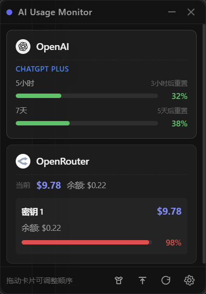
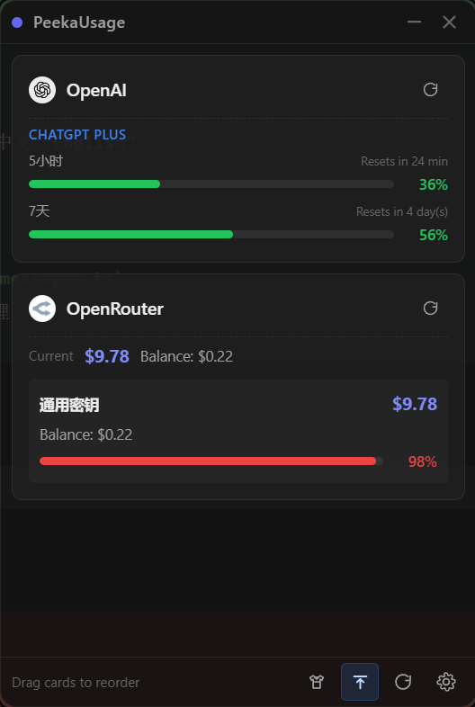
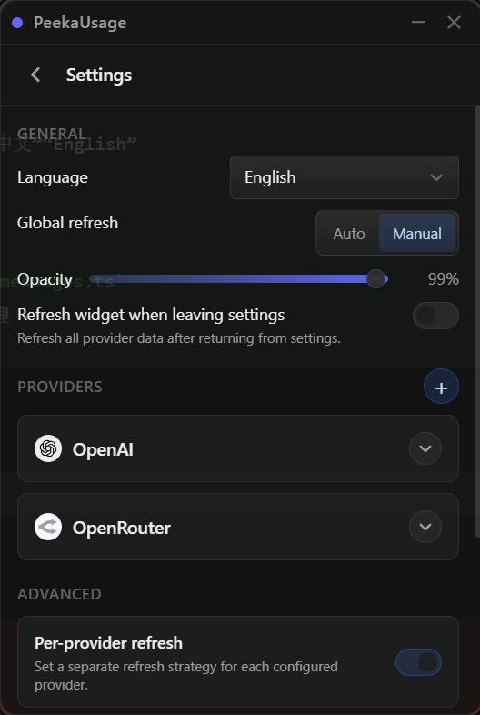
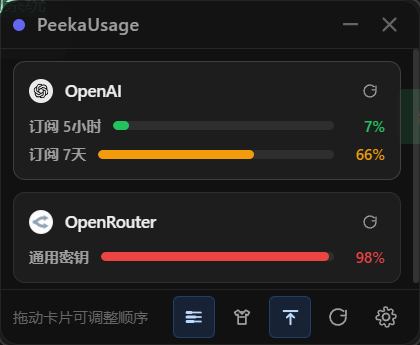

# PeekaUsage

[English README](./README.en.md)

> 一个常驻桌面角落的 AI 用量小浮窗。用来快速查看 OpenAI、Anthropic、OpenRouter、New API 的订阅配额、API 用量、预算、余额和速率限制，少敲几次 `/usage`，少切几次 Dashboard。

<p align="center">
  <a href="https://github.com/StarChen4/PeekaUsage/releases/latest"></a>
  <a href="https://github.com/StarChen4/PeekaUsage/blob/main/LICENSE"></a>
  
  
</p>

<p align="center">
  
  
  
  
</p>

## 它解决什么问题

如果你同时在用 Claude Code、Codex、OpenClaw，或者自己写脚本调 OpenAI / Anthropic / OpenRouter，大概率已经体验过这种日常折磨：

- 跑一会儿就想知道配额还剩多少
- 要反复打开 CLI 敲 `/usage`、`/status`
- 或者去不同供应商 Dashboard 来回切
- 还要担心速率限制、预算、余额和订阅窗口

PeekaUsage 干的事情很简单：**把这些信息钉在桌面角落里，变成一眼就能扫到的状态面板。**

它不是一个新的模型平台，也不是代理层。它就是一个轻量桌面 Widget，让你更快知道：

- 现在花了多少
- 还剩多少
- 哪家快打满了
- 要不要切 Key / 切账号 / 停手

## 适合谁用

- 同时订阅 OpenAI 和 Anthropic 的重度 AI 工具用户
- 一边用 Claude Code / Codex，一边还会直接调 API 的开发者
- 想在桌面常驻查看消耗，而不是反复切终端和网页的人
- 对成本、速率限制、订阅窗口比较敏感的个人开发者或小团队

## 核心特性

### 多供应商总览

- OpenAI、Anthropic、OpenRouter、New API 的按量用量，以及接口实际提供的预算与余额
- New API 支持每把 Key 配置独立站点地址，统一查看多个自建或第三方站点的令牌额度
- OpenAI、Anthropic 的订阅窗口消耗
- Anthropic 额外支持展示更多订阅窗口和 Extra Usage
- 同一个桌面浮窗里统一查看，不用来回切页面

### OAuth 与 API Key 双通路

- 自动检测本地 Claude Code / Codex CLI 的 OAuth Token
- 提供官方获取入口，减少手工找配置的麻烦
- 支持每个供应商保存多个命名 API Key
- 支持校验、清理和一键切换当前系统环境变量

### 真正面向日常使用的小部件体验

- 主界面手动刷新、单卡刷新、托盘刷新
- 自动刷新 / 仅手动两种模式
- 刷新间隔可按秒或按分钟配置
- 支持按供应商独立刷新策略
- 卡片拖拽排序并持久化
- 详细 / 精简两种显示模式
- 设置页内置更新分区，支持检查更新、查看更新说明和安装应用内更新
- 浅色 / 深色 / 跟随系统主题
- 始终置顶、窗口透明度调节
- 系统托盘显示 / 隐藏 / 刷新 / 打开设置
- 简体中文、繁体中文、English 即时切换

首次启动会按系统语言选择界面：简体中文环境使用简体中文，繁体中文环境（含台湾、香港、澳门）使用繁体中文，其他环境或无法识别语言时使用英文。该选择会立即保存，之后继续使用已保存的语言，不随系统语言变化。已有用户配置（包括从旧应用目录迁移的配置）保持原有语言；旧配置缺少语言字段时仍使用简体中文。

## 为什么它可能值得 Star

因为它不是“又一个聊天壳子”或者“又一个模型聚合页”。

它更像是一个 **AI 配额监控小部件**：

- 对经常用 AI 编程工具的人有真实痛点
- 比起命令行和 Dashboard，查看路径更短
- 适合长期挂在桌面角落里当状态指示器
- 对多供应商混用场景尤其友好

如果你也有“AI Token 焦虑”，这玩意儿至少能让你焦虑得更高效一点。社畜式减负，多少算点减负。

## 下载与安装

### 直接下载已构建版本

前往 [GitHub Releases](https://github.com/StarChen4/PeekaUsage/releases/latest) 下载对应平台安装包。

当前仓库会产出：

- Windows：NSIS 安装包
- Linux：DEB / AppImage
- macOS：`app` / `dmg`（`x86_64` 与 `arm64`）

### macOS 说明

- macOS 安装包必须在 Mac 上构建
- 当前尚未接入 Apple Developer 签名与 notarization
- 首次打开如果被系统拦截，可能需要手动放行

如果提示“文件已损坏，无法打开”，可执行：

```bash
xattr -dr com.apple.quarantine /Applications/PeekaUsage.app
```

## 本地开发

### 1. 安装依赖

```bash
npm install
```

### 2. Linux 额外依赖

如果你在 Ubuntu / Debian 上开发或打包，还需要先安装：

```bash
sudo apt-get update
sudo apt-get install -y build-essential curl file libfuse2 libgtk-3-dev libssl-dev libwebkit2gtk-4.1-dev libayatana-appindicator3-dev librsvg2-dev patchelf
```

### 3. 启动前端

```bash
npm run dev
```

### 4. 启动桌面应用

```bash
npm run tauri dev
```

### 5. 基本检查

```bash
npm run typecheck
cargo fmt --all --check
cargo check --manifest-path src-tauri/Cargo.toml
```

首次启动语言与旧配置兼容测试：

```bash
cargo test --manifest-path src-tauri/Cargo.toml config::app_config::tests
```

Linux 本地打包使用 `npm run tauri:build:linux`。项目锁定 Tauri CLI 2.11.4，使用上游修复后的相对图标链接；本地构建、Linux CI 和 Release 共用 `scripts/build-linux.sh`，解包检查本次产物的 `.DirIcon` 是否存在、非空、指向包内 PNG，且不使用构建机绝对路径。Release 检查通过后才上传安装包。也可运行 `bash scripts/check-appimage.sh /路径/PeekaUsage.AppImage` 单独检查产物。

Linux 桌面入口使用 `Utility` 分类。发版流水线通过 `scripts/check-update-manifest.py` 检查 `latest.json` 的版本、四个平台下载条目及签名格式。

Linux 打包还需要 `squashfs-tools`。`beforeBundleCommand` 会调用 `scripts/prepare-appimage.sh`，校验官方启动器的 SHA-256 并将缓存权限设为 `0755`，避免 Tauri 默认 `0770` 导致挂载后普通用户无法执行 `AppRun.wrapped`。产物检查使用 `unsquashfs` 保留原始权限元数据，检查目录可遍历、文件可读，以及启动器和程序对所有用户可执行；运行时的 `--appimage-extract` 会改变目录权限，不能据此判断实际挂载权限。

发版前还需要先补齐对应版本的发版说明文件，例如 `.github/release-notes/v0.1.0.md`，再打 `v0.1.0` 标签并推送。

## 凭据来源

### API Key

你可以在设置页里填，也可以使用环境变量。

| 服务商 | 环境变量 |
| --- | --- |
| OpenAI | `OPENAI_API_KEY` |
| Anthropic | `ANTHROPIC_API_KEY` |
| OpenRouter | `OPENROUTER_API_KEY` |
| New API | `NEWAPI_API_KEY`（同时设置 `NEWAPI_BASE_URL`） |

说明：

- OpenAI 和 Anthropic 的按量成本查询需要各自的组织管理凭据；普通推理 Key 不代表拥有成本查询权限
- OpenAI、Anthropic 返回组织成本，不能理解为当前某一把 Key 的独立消费
- OpenRouter 普通 Key 返回自身用量和生效额度，Management Key 才能查询账户总余额
- 环境变量优先级高于设置页里保存的值
- 设置页支持把某个已保存的 Key 一键切换为当前系统环境变量
- Windows 会写入用户级环境变量；Linux / macOS 会同步当前进程并写入应用托管的 Shell 环境脚本，新开的终端会读取新值

### New API 配置与查询

1. 在“设置 → 供应商”中添加 **New API**。
2. 为每把 Key 填写名称、站点地址与该站点签发的 API 令牌；可添加多把 Key，分别指向不同站点。
3. 点击“验证”检查真实用量查询权限，再保存配置。

站点地址支持 `https://example.com`、`http://localhost:3000`，也支持反向代理子路径；客户端常用的末尾 `/v1` 会自动移除。地址不能包含账号、密码、查询参数或片段。验证使用尚未保存的地址，保存后重启仍保留每把 Key 的站点配置。

- 用量读取 `GET /api/usage/token`，通过 `Authorization: Bearer <令牌>` 认证，展示当前令牌的累计已用、总额度和剩余额度，**不是账户总余额或模型 Token 数**。
- 通过不带令牌的 `GET /api/status` 读取 `quota_per_unit`，将原始额度除以站点比例后统一显示美元等值；不沿用站点人民币或自定义币种的展示汇率。
- 无限额度令牌保留累计已用量，详细模式明确显示“令牌无限额度”，精简模式显示 `∞`，提示该状态不代表账户余额无限；预算和剩余额度不伪造为零。接口的到期时间不作为用量重置时间。
- 站点未开放这些接口、未提供有效换算比例、返回认证失败或异常结构时会明确报错，不显示虚假的零用量；不发送模型生成请求。
- 查询、单卡刷新、自动轮询、拖拽排序、精简/详细视图及统计历史沿用现有供应商流程。更换站点或换算比例时重新建立消费增量基线，保留已有历史。
- 显式点击“切换环境”才同步 `NEWAPI_API_KEY` 和 `NEWAPI_BASE_URL`；普通保存不会接管系统环境。删除当前激活 Key 时会清除这两个由应用管理的变量。

接口依据：[New API 令牌用量文档](https://doc.newapi.pro/api/token-usage/)、[官方令牌查询实现](https://github.com/QuantumNous/new-api/blob/main/controller/token.go)、[官方站点配置实现](https://github.com/QuantumNous/new-api/blob/main/controller/misc.go)。不同站点或分支可能关闭、修改接口；当前通过本地 HTTP 样本验证，未使用真实站点凭据在线验证。New API 图标取自[官方项目资源](https://github.com/QuantumNous/new-api/blob/main/web/public/logo.png)，统一通过 `ProviderIcon.tsx` 渲染。

### OAuth Token

订阅数据会优先从本地工具凭据里自动检测。

> 注意：Anthropic 订阅接口查得太频繁可能返回 HTTP 429。

| 来源 | 文件路径 | 字段 |
| --- | --- | --- |
| Claude Code | `~/.claude/.credentials.json` | `claudeAiOauth.accessToken` |
| Codex CLI | `~/.codex/auth.json` | `tokens.access_token` |

说明：

- OpenAI 的 `tokens.access_token` 同时兼容字符串和索引对象两种格式
- OpenAI 凭据也可能保存在系统凭据库，而不一定存在 `~/.codex/auth.json`
- OpenRouter 当前没有订阅 OAuth 查询

## 接口兼容说明（2026-10-15）

| 查询通路 | 当前处理方式 | 核对来源 |
| --- | --- | --- |
| OpenAI API 成本 | 使用组织 Admin API Key 调用 `/v1/organization/costs`，累计全部分页；`amount.value` 已是对应币种金额，美元不能再除以 100。公开成本接口没有余额与预算，界面按未提供处理。 | [官方成本接口](https://developers.openai.com/api/reference/resources/admin/subresources/organization/subresources/usage/methods/costs) |
| Anthropic API 成本 | 使用 `/v1/organizations/cost_report` 的 `starting_at` / `ending_at` 参数，读取 `data[].results[].amount` 十进制字符串，按美分换算美元并累计全部分页。 | [官方用量与成本文档](https://platform.claude.com/docs/en/manage-claude/usage-cost-api) |
| OpenRouter API 用量 | 普通 Key 查询 `/api/v1/key`，优先使用 `effective_budget`，其次按 `limit_remaining` 和额度周期处理；Management Key 才查询 `/api/v1/credits` 的账户总额。已废弃的 `rate_limit` 不再当作实时限额。 | [Key 接口](https://openrouter.ai/docs/api/api-reference/api-keys/get-current-api-key)、[余额接口](https://openrouter.ai/docs/api/api-reference/credits/get-remaining-credits) |

界面会区分当前 Key、组织成本、账户总额与共享预算。多把管理密钥可能读到同一份数据，因此组织、账户或共享预算不再直接相加为供应商合计；缺少可计算的预算时，精简模式显示 `—`，不会误报为 `0%`。

Claude 与 Codex 的 OAuth 订阅查询继续兼容当前已知的客户端内部接口结构，保留额外模型窗口和 Extra Usage。内部接口没有公开稳定性承诺，本次没有使用真实账号凭据做在线验证；接口返回未知或不完整结构时会明确报解析错误，不会静默显示零用量。Extra Usage 有额度与已用金额时据此计算百分比，不再盲目将利用率乘以 100；没有返回的重置时间不自行猜测。

所有用量请求均有连接和总请求超时，认证失败、HTTP 429 和服务错误不会伪装成成功。应用不再为探测速率限制发送 Anthropic 模型生成请求。设置页的 Key 验证检查实际用量查询权限，而不是只检查能否列举模型。

执行 `cargo test --lib --manifest-path src-tauri/Cargo.toml` 可验证请求路径、参数、分页、金额单位、额度范围、订阅窗口和错误响应。测试使用本地 HTTP 服务与构造的响应样本，不会调用真实供应商或消耗模型额度；CI 在三个桌面平台执行这些测试。旧版已经记录的历史统计不会被自动重算或清除；旧样本与新口径之间、不同用量范围切换时会跳过跨界增量，避免产生虚假的消费突增。

## 支持平台

- Windows
- Linux
- macOS

## 项目结构

```text
src/
  components/
  composables/
  stores/
  utils/

src-tauri/src/
  commands/
  config/
  providers/
  tray/
```

## 为什么还没有支持所有模型提供商

因为有些提供商没有公开、稳定、可维护的官方接口；当然，也有一部分原因是作者精力有限，社畜下班后体力条见底。

如果你正在用某个还没接入的 provider，欢迎提 PR。比较理想的贡献包括：

- Rust 侧 provider 实现和类型定义
- 前端 provider 展示与设置项
- 对应文档、环境变量、图标资源和验证步骤

只要数据来源可靠、行为边界清楚、不会把现有交互搞坏，就很欢迎一起补。

## Roadmap

欢迎提 Issue / PR，比较值得继续做的方向包括：

- 接入更多支持官方用量接口的 provider
- 更完整的异常态与错误提示
- 更丰富的桌面 Widget 展示样式
- 更好的首启配置引导
- 已签名 / 已 notarize 的 macOS 发布流程

## 贡献

如果你想帮忙，Issue、PR、功能建议都欢迎。

如果这个项目对你有帮助，欢迎点个 Star —— 这玩意儿至少能让我知道不是只有我一个人在被配额折磨。

## License

[MIT](./LICENSE)
